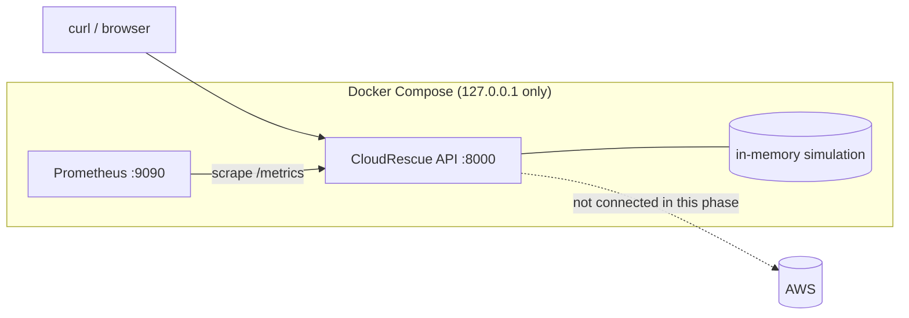

# CloudRescue

A small, beginner-friendly **incident/recovery simulation** built as a foundation for a later AWS deployment.
A FastAPI service exposes health, status, incident history and Prometheus metrics, and lets you **simulate** a failure and a
recovery in memory. Docker Compose runs it with a minimal Prometheus. Terraform describes a future AWS environment, and GitHub Actions
checks code and Terraform without any AWS credentials.

> **Honest scope:** this phase is 100% local. **No AWS API is called, no AWS resource exists, and nothing is deployed.**
> Every incident is *simulated*; none represents a real AWS failure or recovery.

## Why this project

It practises the day-to-day loop of a junior Cloud/DevOps engineer on a safe, free, local target: build an API, containerise it,
expose metrics, test it, validate infrastructure code, and wire up CI, while documenting the cost and security decisions
needed before touching a real cloud account.

## Architecture



| Component | Responsibility |
|---|---|
| `app/state.py` | Healthy/failed state machine and bounded incident history (pure standard library) |
| `app/routes.py`, `app/models.py` | Endpoints and Pydantic models |
| `app/main.py` | App factory, request ids, JSON logs, consistent error bodies, metrics middleware |
| `app/metrics.py` | Prometheus metrics (`cloudrescue_simulated_*` are simulation; `cloudrescue_aws_*` is AWS config) |
| `prometheus/` | Scrape config and a `SimulatedServiceDown` alert rule |
| `terraform/` | Future AWS environment (network, IAM, compute, monitoring modules): **never applied** |
| `.github/workflows/ci.yml` | Lint, format, tests, Terraform fmt/validate, Docker build and smoke test |

More: [docs/architecture.md](docs/architecture.md), [docs/aws-deployment-plan.md](docs/aws-deployment-plan.md), [terraform/README.md](terraform/README.md).

## Prerequisites

Ubuntu 24.04 (WSL2), Python 3.12 with `python3.12-venv` (Ubuntu 24.04 ships 3.12: `sudo apt install python3-venv make curl`),
Docker Desktop with WSL integration enabled for your distro, Git, and optionally Terraform for the Terraform checks.
Keep the project in the Linux filesystem (for example `/home/achyut/cloud-projects/cloudrescue`), not under `/mnt/c`.

## Local setup (virtual environment)

```bash
cd /home/achyut/cloud-projects/cloudrescue
make install                 # creates .venv and installs requirements-dev.txt
make format                  # first time only: applies ruff formatting so `make lint` passes
make test
make run                     # http://127.0.0.1:8000/docs
```

Without `make`:

```bash
python3 -m venv .venv
.venv/bin/python -m pip install -r requirements-dev.txt
.venv/bin/python -m pytest
.venv/bin/uvicorn app.main:app --reload --host 127.0.0.1 --port 8000
```

## Docker Compose

```bash
docker compose up -d --build     # build and start (or: make docker-up)
docker compose ps                # both services should show "healthy"
docker compose logs -f cloudrescue
docker compose down              # stop and remove (or: make docker-down)
```

* API: http://127.0.0.1:8000 (docs at `/docs`)  * Prometheus: http://127.0.0.1:9090
* Ports bind to localhost only. If 8000/9090 are taken (for example by CloudOps360), set `CLOUDRESCUE_HOST_PORT` / `PROMETHEUS_HOST_PORT`
  in `.env` (copy `.env.example`).
* No named volumes: state is in memory and Prometheus data is disposable.

### Verify Prometheus sees the app

1. Open http://127.0.0.1:9090/targets: job `cloudrescue` should be **UP**.
2. Query `cloudrescue_simulated_service_up` in the Graph tab: `1` = healthy.
3. After simulating a failure the value becomes `0`, and after 30 s the `SimulatedServiceDown` alert shows under **Alerts**
   (there is no Alertmanager, so nothing is sent anywhere).

## API

| Method | Path | Description | Notable responses |
|---|---|---|---|
| GET | `/` | Project info and links to the docs | 200 |
| GET | `/health` | Process liveness (independent of the simulation) | 200 |
| GET | `/api/status` | Simulated service state, runtime mode, UTC time, AWS configuration | 200, **503** while a simulated failure is active |
| GET | `/api/incidents?status=open\|resolved&limit=1..100` | Incident history, newest first; all marked `simulated` | 200, 422 |
| POST | `/api/demo/simulate-failure` | Start a simulated failure (body optional: `reason`, `severity`) | 201, 409 if already failed, 422, 403/401 if protected |
| POST | `/api/demo/recover` | Restore the simulated service | 200, 409 if already healthy |
| GET | `/metrics` | Prometheus metrics | 200 |

```bash
curl -s localhost:8000/api/status | python3 -m json.tool
curl -s -X POST localhost:8000/api/demo/simulate-failure \
  -H 'Content-Type: application/json' -d '{"reason": "demo crash", "severity": "high"}'
curl -si localhost:8000/api/status | head -1          # HTTP/1.1 503 Service Unavailable
curl -s -X POST localhost:8000/api/demo/recover
curl -s localhost:8000/api/incidents | python3 -m json.tool
```

Or run the whole walkthrough against a running API: `make demo` (`scripts/demo.sh`).

Example `GET /api/status` (healthy):

```json
{
  "service": "cloudrescue",
  "version": "0.1.0",
  "timestamp": "2026-10-10T12:00:00Z",
  "runtime_mode": "local-simulation",
  "environment": "local",
  "simulated_service": {"state": "healthy", "since": "2026-10-10T11:58:00Z", "open_incident_id": null, "simulated": true},
  "aws": {"integration_implemented": false, "configured": false, "region": null, "status": "not_checked", "note": "..."}
}
```

### Simulate a failure and recover

1. `POST /api/demo/simulate-failure` -> 201, incident #1 `open`, `simulated: true`.
2. `GET /api/status` -> **503**, `simulated_service.state = "failed"`; `GET /health` is still 200 (the process is alive).
3. `POST /api/demo/recover` -> 200, incident `resolved`.
4. `GET /api/status` -> 200 again. Repeating either step out of order returns 409.

## Tests, lint and Terraform checks

```bash
make test           # pytest: endpoints, transitions, history, validation, metrics, AWS/simulation separation
make lint           # ruff check + ruff format --check
make format         # apply formatting (run once on a fresh checkout)
make tf-validate    # terraform fmt -check, init -backend=false, validate (no AWS calls, no apply)
```

## Security boundaries

* Demo endpoints modify **in-memory state only**, but anyone who can reach them can flip the service to "failed" and pollute
  history. They are meant for local use.
* **Before any public deployment** set `CLOUDRESCUE_DEMO_ENDPOINTS_ENABLED=false` (returns 403) or at least set
  `CLOUDRESCUE_DEMO_TOKEN` (requires `X-Demo-Token`) *and* restrict the network path. The Terraform compute module already starts the
  container with the demo endpoints disabled.
* The API has no user accounts; `/metrics`, `/api/status` and `/api/incidents` are unauthenticated.
* The container runs as a non-root user with a read-only filesystem and dropped capabilities; ports bind to `127.0.0.1`.
* No credentials exist in this repository; `.env` is git-ignored and `.env.example` holds placeholders only.
* There is no endpoint that terminates, restarts or modifies AWS resources, and no AWS SDK is installed.

## Cost risks of the future AWS deployment

Not incurred today. Later: EC2 (small), public IPv4 (~USD 3.60/month), NAT gateway (~USD 32/month, deferred), ALB
(~USD 16+/month, deferred), CloudWatch ingestion. Details and teardown: [docs/aws-deployment-plan.md](docs/aws-deployment-plan.md).

## Current implementation versus planned work

| Area | Status |
|---|---|
| FastAPI endpoints, simulation, metrics, structured logs | Implemented |
| pytest suite | Written (see "Verification status") |
| Dockerfile, Compose, Prometheus + alert rule | Written (see "Verification status") |
| Terraform: network, iam, compute, monitoring modules | Written, **never planned or applied** |
| GitHub Actions CI | Written, **has not run on GitHub yet** |
| Real AWS integration (read-only status checks) | **Not implemented** |
| ECR image publishing, remote state, OIDC deploy roles | Not implemented |
| ALB, Auto Scaling, NAT gateway, SNS notifications | Not implemented (deferred) |
| Authentication/authorisation for the API | Not implemented |

## Verification status

Fill this in on your machine; do not treat the project as verified until the first three rows pass.

| Check | Command | Result |
|---|---|---|
| Unit/API tests | `make test` | _not yet run by you_ |
| Lint + format | `make format && make lint` | _not yet run by you_ |
| Docker stack | `make docker-up && make docker-ps` | _not yet run by you_ |
| Prometheus target UP | http://127.0.0.1:9090/targets | _not yet run by you_ |
| Terraform | `make tf-validate` | _not yet run by you_ |
| GitHub Actions | push and open the Actions tab | _not yet run_ |

## Troubleshooting

| Symptom | Fix |
|---|---|
| `python3.12: command not found` | `sudo apt install python3 python3-venv`, or `make install PYTHON=python3` |
| `ensurepip is not available` | `sudo apt install python3-venv` |
| Compose: port already allocated | Another stack uses 8000/9090: set `CLOUDRESCUE_HOST_PORT` / `PROMETHEUS_HOST_PORT` in `.env` |
| `docker: command not found` in WSL | Docker Desktop -> Settings -> Resources -> WSL integration -> enable your distro |
| Prometheus target DOWN | `docker compose ps` (API must be healthy); target is `cloudrescue:8000` inside the Compose network |
| `bash\r: No such file` | CRLF line endings: `sed -i 's/\r$//' scripts/*.sh`; `.gitattributes` forces LF in Git |
| `make lint` fails on formatting | `make format` once, then commit |
| `terraform init` fails | Needs internet to download the AWS provider (no AWS credentials needed) |
| Status unexpectedly returns 503 | A simulated failure is active: `POST /api/demo/recover` (or restart the app: state is in memory) |

Cleanup: `docker compose down`, `make clean` (removes `.venv` and caches). Nothing exists in AWS to clean up.

## Interview talking points

These describe what the code is designed to do; run the checks above before claiming results.

* **Separation of concerns:** simulated state and AWS configuration are different sections, different metric names and different tests,
  so a demo can never be mistaken for a real recovery.
* **HTTP semantics:** `/health` is liveness (200 while the process runs); `/api/status` returns 503 while the *simulated* service is
  failed; 409 for invalid transitions; 422 for validation.
* **Safe demo endpoints:** off-switch, optional token, and a documented requirement to protect or disable them publicly.
* **Observability:** per-app Prometheus registry, route-template labels (no cardinality blow-up), a simulated-failure alert rule.
* **Infrastructure as code with cost control:** compute off by default, no NAT gateway, no SSH, least-privilege role,
  environment values in tfvars not modules, deferred items listed instead of stub modules.
* **Honesty about status:** README separates implemented, written-but-unverified and not-implemented work.
* **CI without secrets:** read-only token, no AWS credentials; OIDC plan documented for later.

## License

Add a license of your choice before publishing.
