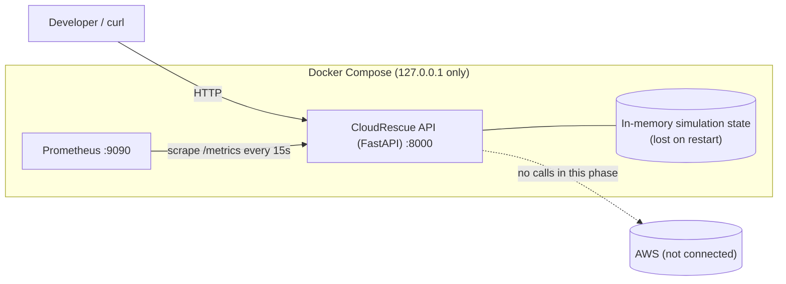
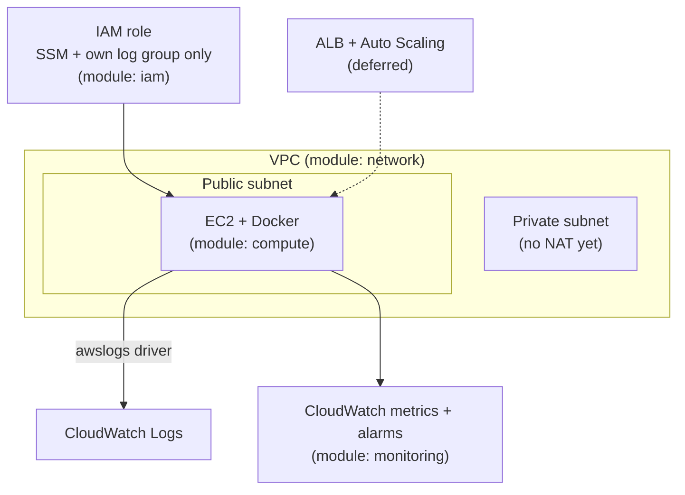

# Architecture

## Current (implemented and runnable locally)

## Planned (Terraform written, never applied)

## Components

| Component | Responsibility | Files |
|---|---|---|
| FastAPI app | Endpoints, validation, error format, request ids, JSON logs | `app/main.py`, `app/routes.py`, `app/models.py` |
| Simulation state | Thread-safe healthy/failed state machine and bounded incident history (standard library only) | `app/state.py` |
| Metrics | Per-app Prometheus registry; `cloudrescue_simulated_*` for the simulation, `cloudrescue_aws_*` for AWS config | `app/metrics.py` |
| Config | Environment-variable settings with safe defaults | `app/config.py` |
| Prometheus | Scrapes `cloudrescue:8000/metrics`, one alert for the simulated failure | `prometheus/` |
| Terraform | Future AWS environment definition | `terraform/` |

## Simulation versus AWS

The simulation and AWS information are separate on purpose:

* `GET /api/status` has `simulated_service` (changes with the demo endpoints) and `aws` (never changes with the simulation).
* `aws.integration_implemented` is `false` and `aws.status` is `not_checked`; `aws.configured` only reflects whether a future
  target region + instance id were described through environment variables.
* Every incident carries `simulated: true` and `source: "local-simulation"`.
* Metric names containing `simulated` can never be mistaken for real signals.

## HTTP semantics

| Situation | Response |
|---|---|
| Process alive | `GET /health` -> 200 (independent of the simulation) |
| Simulated service failed | `GET /api/status` -> 503 with the normal body |
| Failure simulated | `POST /api/demo/simulate-failure` -> 201 |
| Failure when already failed / recover when healthy | 409 |
| Invalid body or query | 422 with `details` |
| Demo endpoints disabled | 403; missing/invalid `X-Demo-Token` -> 401 |
